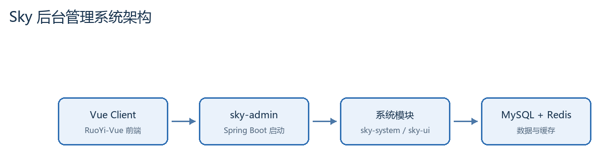

# 苍穹外卖课程项目（RuoYi 服务端）

基于 RuoYi 3.9.2 的苍穹外卖课程项目服务端初始化版本，保留 RuoYi 的系统管理、代码生成、定时任务和监控能力，可作为后续外卖业务模块的开发基础。

## 系统架构

前端通过 REST API 调用 sky-admin，sky-system 提供系统管理能力，sky-ui 提供内置界面资源，MySQL 存储业务数据，Redis 提供缓存支持。

## 功能范围

| 模块 | 说明 |
| --- | --- |
| 系统管理 | 用户、角色、菜单、部门、字典 |
| 系统监控 | 在线用户、定时任务、日志、缓存 |
| 代码生成 | 数据表导入与模板生成 |
| 基础框架 | 权限、JWT、异常处理、分页 |

## 技术栈

- Java 17、Spring Boot、Spring MVC
- MyBatis、PageHelper、Druid
- MySQL、Redis
- Maven 多模块

## 环境要求

- JDK 17+
- Maven 3.8+
- MySQL 8.0+
- Redis 6.0+

## 配置

配置文件位于 sky-admin/src/main/resources/application.yml 和 application-druid.yml。

数据库默认库名：ry-vue。数据库脚本位于 sql/ 目录。

敏感配置已改为环境变量：

~~~bash
export MYSQL_USERNAME=root
export MYSQL_PASSWORD=your-secret-here
export REDIS_PASSWORD=
export TOKEN_SECRET=change-me
~~~

## 启动方式

1. 创建 MySQL 数据库并导入 sql/ 下的脚本；
2. 启动 Redis；
3. 在项目根目录执行：

~~~bash
mvn clean package
java -jar sky-admin/target/sky-admin.jar
~~~

或在 IntelliJ IDEA 中运行 com.sky.RuoYiApplication。

## 关联仓库

- 前端：[RuoYi-vue-sky-take-out-client](https://github.com/Smasun0721/RuoYi-vue-sky-take-out-client)

## 说明

本项目是课程项目的初始化版本，业务模块尚未完全实现；仓库保留 RuoYi 原始结构和课程实验代码，便于继续开发或作为脚手架参考。
